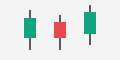

# 写法示例

这一页演示文档页面的各种写法：标题、表格、代码块、链接和图片。正文里的中文词，比如均线指标、成交量和交易日历，都能搜到。

## 链接

- 同一页的标题：[代码块](#代码块)
- 别的页面和它的标题：[按成交生成 K 线](live.md#按成交生成-k-线)
- API 里的符号：[`createChart()`](../api.md#createChart)、[`DataApi.set()`](../api.md#DataApi.set)、[Vue 的 `KumoChart`](../api.md#vue:KumoChart)
- 仓库里的文件：[核心包的入口](../../../../../packages/core/src/index.ts)
- 外部地址：[币安公开数据](https://data.binance.vision/)

## 表格

| 周期  | 由什么合成     |
| ----- | -------------- |
| `5m`  | 5 根 1 分钟线  |
| `15m` | 3 根 5 分钟线  |
| `1h`  | 4 根 15 分钟线 |

## 代码块

代码片段前面可以放一段隐藏的前置代码，类型检查时拼在每个片段前面，页面上看不到。

<!-- code-prelude
import { createChart } from '@kumochart-sdk/core';
import { indicators, MA, MACD } from '@kumochart-sdk/core/indicators';

const chart = createChart(document.createElement('div'), { modules: [indicators([MA, MACD])] });
-->

```ts
chart.indicators.add({ type: 'MA', params: { periods: [5, 10, 20] } });
chart.indicators.add({ type: 'MACD' });
```

不做类型检查的片段写 `no-check`：

```ts no-check
chart.indicators.add({ type: 'MA', … });
```

### 其他语言

```bash
npm install @kumochart-sdk/core
```

```json
{ "type": "MA", "params": { "periods": [5, 10, 20] } }
```

## 图片


